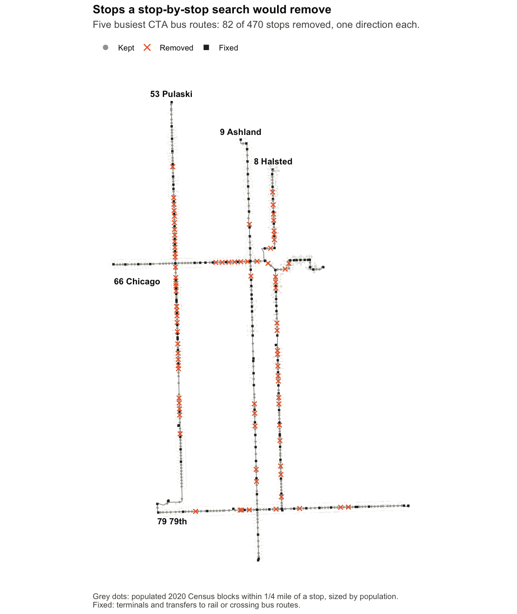
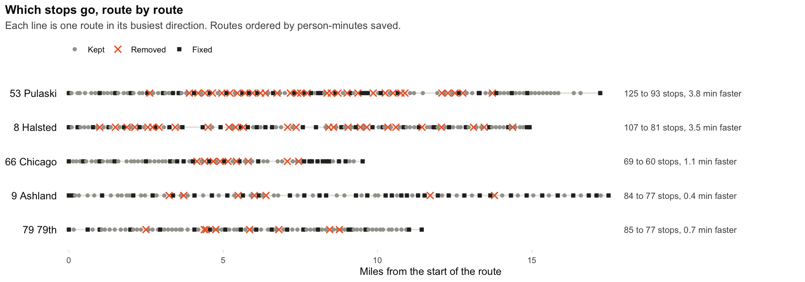
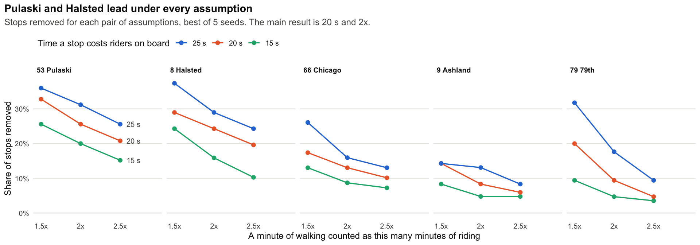
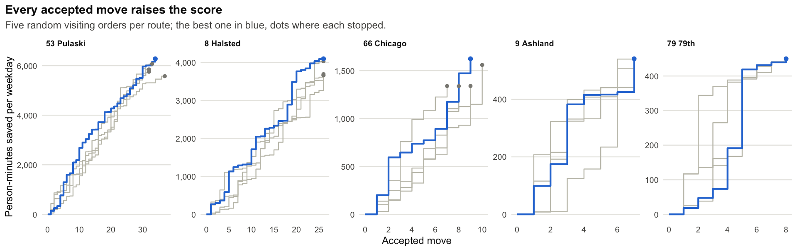

# Bus stop consolidation

> **A personal project.** I built this on my own time to explore a planning question with public data.
> It is not affiliated with, sponsored by or endorsed by the Chicago Transit Authority, the City of
> Chicago or any employer, and it is not a recommendation to remove any specific stop.

Which stops on Chicago's five busiest bus routes could go? Every stop a bus makes costs the riders on
board time; every stop removed makes some people walk farther. This project scores that tradeoff in
weekday person-minutes and searches for the best set of stops one stop at a time: try removing (or
restoring) a stop, keep the change if the score improves, and stop when no single change helps.

Written in R with sf, dplyr and ggplot2, using public data only: the CTA schedule (GTFS), CTA ridership
by route from the City of Chicago data portal, and 2020 Census blocks.



## Results

Weekday, one direction per route (the pattern with the most trips), best of five random search orders.

| Route | Stops | Mean spacing (ft) | Stops made per trip | Trip time saved | Added walk (mean) | Net person-minutes saved per weekday |
|---|---|---|---|---|---|---|
| 53 Pulaski | 125 to 93 | 733 to 988 | 65.8 to 54.4 | 3.8 min | 65 ft | 6,278 |
| 8 Halsted | 107 to 81 | 744 to 985 | 58.6 to 48.1 | 3.5 min | 62 ft | 4,097 |
| 66 Chicago | 69 to 60 | 739 to 852 | 40.1 to 36.7 | 1.1 min | 23 ft | 1,623 |
| 9 Ashland | 84 to 77 | 1,112 to 1,215 | 48.6 to 47.4 | 0.4 min | 7 ft | 541 |
| 79 79th | 85 to 77 | 719 to 794 | 47.2 to 45.2 | 0.7 min | 15 ft | 450 |

"Stops made per trip" is expected, not scheduled: a bus skips a stop when nobody is waiting or getting
off. Net savings are riding minutes saved minus twice the walking minutes added. Every column is in
[`output/summary.csv`](output/summary.csv), and the stop-by-stop result for each route (which stops
stay, which go, and why a stop is fixed) is in `output/stops_<route>.csv`.



- **Pulaski and Halsted carry the most extra stops.** About a quarter of their stops go, buses make
  10 or 11 fewer stops per trip, and trips get 3.5 to 4 minutes faster for about 60 ft more walking on
  average.
- **Stops come out mid-route, not at the ends.** Riders build up toward the middle of a route, so that
  is where skipping a stop saves the most person-minutes. Near the ends the bus is nearly empty.
- **Ashland already has wide spacing** (1,112 ft against about 730 on the others), and 36 of its 84
  stops are transfer points, so there is little left to remove.
- **79th has close spacing but little to gain.** Its stops are well used, so removing one moves many
  people for a small saving.
- **Spacing ends up around 850 to 1,000 ft,** short of the quarter mile (1,320 ft) that consolidation
  programs often aim for. Walking minutes count double and transfer stops never move, which holds the
  search back.

## How much the assumptions matter

Two settings are judgment calls: how much time a stop costs the riders on board, and how much worse a
minute of walking feels than a minute of riding. `R/04_sweep.R` reruns the search for every pair on a
3 x 3 grid (15, 20 or 25 seconds per stop; walking counted at 1.5x, 2x or 2.5x).



| Route | Stops removed, all nine settings | At 15 s and 2.5x (fewest) | At 25 s and 1.5x (most) |
|---|---|---|---|
| 53 Pulaski | 19 to 45 | 19 | 45 |
| 8 Halsted | 11 to 40 | 11 | 40 |
| 66 Chicago | 5 to 18 | 5 | 18 |
| 79 79th | 3 to 27 | 3 | 27 |
| 9 Ashland | 4 to 12 | 4 | 12 |

The full grid, with person-minutes, is in [`docs/runs/04_sweep.md`](docs/runs/04_sweep.md).

- **The ranking holds.** Pulaski and Halsted remove the most stops and save the most person-minutes
  under all nine settings.
- **Only the ratio of the two settings matters.** Scaling both by the same factor (15 s with 1.5x,
  20 s with 2x, 25 s with 2.5x) removes exactly the same stops; only the person-minutes scale. The
  question an agency has to answer comes down to one number: how many seconds of riding is a foot of
  walking worth?
- **79th is the most sensitive route** (3 to 27 stops): many of its stops sit near the break-even
  point, so a small change in the settings tips them together.

## The model

For one route direction with `T` weekday trips and `R` weekday riders:

1. **Walking.** A Census block belongs to the route if a stop is within a quarter mile of it today.
   Each block's residents walk to the nearest stop that is kept. Chicago's street grid lines up with
   the Illinois State Plane East coordinate system, so walking distance is Manhattan distance (east-west
   plus north-south) in that system.
2. **Demand per stop.** `s_i` is the share of the route's residents whose nearest kept stop is `i`.
3. **Trips along the route.** Riders from stop `j` to a later stop `k` are proportional to
   `s_j * s_k` (a gravity model). That gives closed forms: riders on board through stop `i` are
   `R * before_i * after_i / Z`, and riders getting on or off are `R * s_i * (1 - s_i) / Z`, where
   `before` and `after` are the cumulative shares and `Z = (1 - sum of s^2) / 2`.
4. **Does the bus stop?** With `a` riders getting on or off per trip, the bus stops with probability
   `1 - exp(-a)`. A quiet stop is often skipped anyway, so removing it saves less.
5. **Cost** = for each stop, the chance the bus stops x the riders on board x 20 seconds, plus 2 x the
   walking minutes at both ends of every trip, at 3 mph. **Score** = today's cost minus the new cost, so
   today's stops score 0.

**Rules.** Terminals stay. Stops within 300 ft of a rail station, or of a stop on a crossing bus route
(streets meeting at 45 to 135 degrees), stay. Removing stops may not open a gap over half a mile.
Gaps that already exist in today's schedule, such as across rail yards, are allowed, which is why a few
routes show a longest gap over half a mile in `summary.csv`.

**The search.** Start from today's stops. Each pass visits the stops that are allowed to change in a
random order and tries switching each one (remove it if kept, restore it if removed); the switch stays
only if it follows the rules and raises the score. The search ends after a pass with no improvement.
It runs with five random orders per route and keeps the best.



**Settings** live in `PARAMS` at the top of [`R/fns.R`](R/fns.R): `penalty_s = 20`,
`walk_ft_per_min = 264`, `walk_weight = 2`, `catchment_ft = 1320`, `max_gap_ft = 2640`,
`transfer_ft = 300`.

### What it leaves out

- **Fixed ridership.** Nobody stops riding because the walk got longer, and faster trips attract no one.
- **Residents only.** Jobs, schools, hospitals and shops draw riders too. Stop-level boardings would be
  a better demand measure, but CTA does not publish them on the open data portal.
- **One direction, one pattern per route.** Short-turn trips are counted as full-length trips.
- **Straight Manhattan distance** ignores the river, rail embankments, expressways and missing streets.
- **No accessibility rules.** A real consolidation would keep stops at senior housing, hospitals and
  hard crossings; this one protects only terminals and transfers.
- **Route 66's east end** follows the shape in the September 2026 schedule, which leaves Chicago Avenue
  near the river (possibly a detour; not checked).

## Run it

Needs R 4.6 or later.

```
Rscript R/00_setup.R                      # install packages at the versions in renv.lock
Rscript R/02_search.R                     # the search, five routes x five orders (about 3 s)
Rscript R/03_plot.R                       # figures
Rscript R/04_sweep.R                      # sensitivity grid (about 15 s)
Rscript -e 'testthat::test_dir("tests")'  # model tests on small hand-built routes
```

Steps 2 to 4 run from the inputs committed in `data/processed/`. To rebuild those inputs from the
original sources, run `Rscript R/01_prep.R` first: it downloads the CTA schedule, the ridership and
the 2020 Census blocks for Illinois into `data/raw/` (about 380 MB) and rewrites `data/processed/`.
CTA publishes a new schedule every few weeks, so a later download can give slightly different results.
The committed results use the schedule published on 2026-09-14 (service day Wednesday 2026-09-16).

### Files

| Path | What it is |
|---|---|
| `R/fns.R` | The model and the search: `route_cost()`, `is_valid()`, `climb()` |
| `R/01_prep.R` | Downloads and prepares the inputs |
| `R/02_search.R` | Runs the search; writes `output/summary.csv`, `stops_<route>.csv`, `search_log_<route>.csv` |
| `R/03_plot.R` | `output/overview.png`, `stops.png`, `search.png` |
| `R/04_sweep.R` | `output/sweep.csv`, `sweep.png` |
| `data/processed/` | Route stops and shapes (`routes.gpkg`, `routes.csv`) and the Census blocks they serve (`blocks.gpkg`) |
| `docs/runs/` | Notes written by each step: counts, totals and tables |
| `tests/` | testthat tests on small routes worked out by hand |

## Data and credits

- **CTA schedule (GTFS)**, [Chicago Transit Authority](https://www.transitchicago.com/developers/gtfs/),
  used under the CTA Developer License Agreement.
- **CTA bus ridership, daily totals by route**,
  [City of Chicago data portal](https://data.cityofchicago.org/Transportation/CTA-Ridership-Bus-Routes-Daily-Totals-by-Route/jyb9-n7fm):
  weekday mean from July 2025 to June 2026, split evenly between directions.
- **2020 Census blocks with population** (TIGER/Line `tl_2020_17_tabblock20`), U.S. Census Bureau.

## Disclaimer

This is a personal project, made independently for learning and exploration. It is not affiliated with,
sponsored by or endorsed by the Chicago Transit Authority, the City of Chicago or any employer, and the
results are a simplified model, not a proposal for any route or stop.

## License

Code: [MIT](LICENSE). The data keeps the terms of its sources above.
